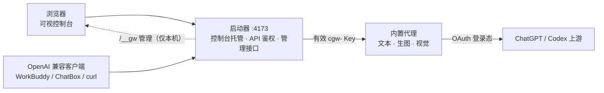
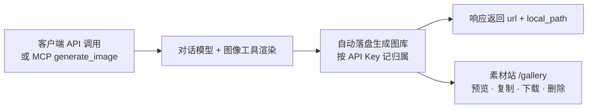
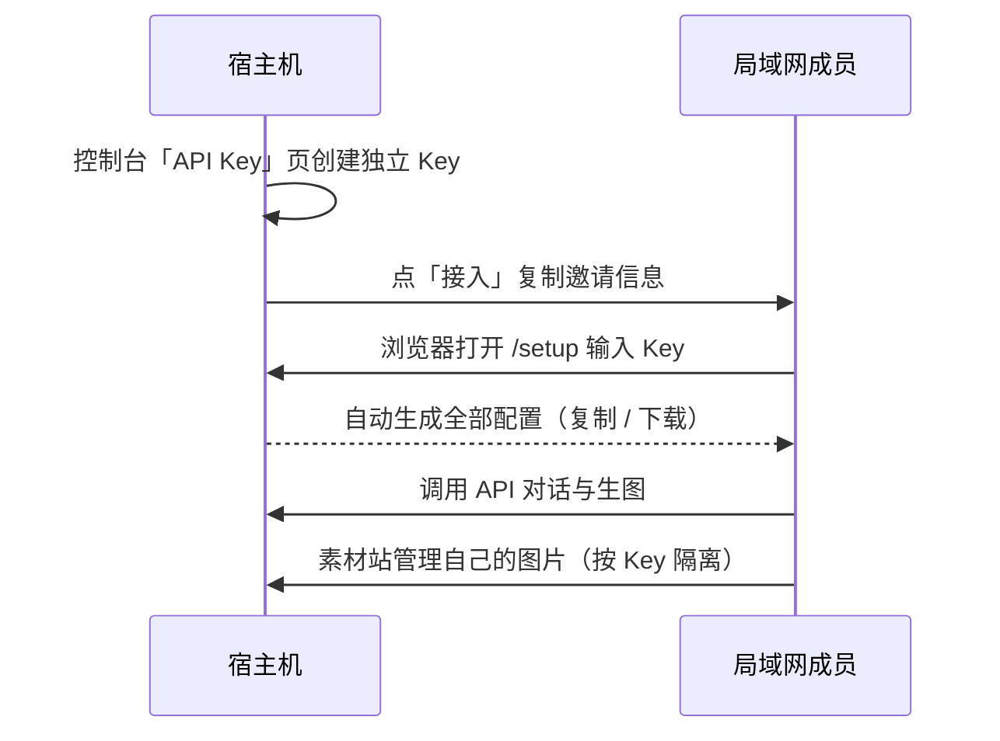

# Codex Gateway

**本地化的 ChatGPT / Codex 接入网关**：用你自己的 ChatGPT 订阅（OAuth 登录态），对外提供标准 **OpenAI 兼容 API**，覆盖**文本对话、图片生成、视觉理解**能力，并附带可视化管理控制台。

- **开箱即用**：无需数据库、无需容器，Node.js 直接运行；Windows 发布包双击即用
- **默认仅本机**：只监听 `127.0.0.1`；需要时一键开启局域网共享（分用户隔离）
- **可视控制台**：账号登录与多账号切换、用量监控、模型管理、API Key 签发、调用日志、图片素材管理

| 你的角色 | 入口 |
|---|---|
| **宿主机**（自己用 / 给同事发 Key） | 本页[快速开始](#快速开始宿主机) |
| **局域网用户**（用别人电脑上的网关） | 浏览器打开 `http://<宿主机IP>:4173/setup`，输入管理员发的 Key，按页面指引复制/下载配置即可（**零命令行**） |
| **维护者**（构建发布包） | [`docs/RELEASE.md`](docs/RELEASE.md) |

> 使用前请务必阅读[合规与使用须知](#合规与使用须知)。

## 功能总览

- **OpenAI 兼容 API**：`/v1/chat/completions`、`/v1/responses`、`/v1/models`、`/v1/images/generations`——任意 OpenAI 兼容客户端（WorkBuddy、ChatBox、Open WebUI、curl 等）填地址 + Key 即用
- **图片生成**：API 直接生图，或以 **MCP 工具**供任意支持 Function Calling 的模型 / Agent 调用；生成结果自动进入**分用户网页素材站**（预览 / 复制链接 / 下载 / 删除）
- **局域网共享**：一条命令开放给同网段设备；每个成员使用独立 API Key，调用与图片素材按 Key 隔离
- **多账号登录**：控制台内完成 OAuth 授权，支持多账号保存与切换；可配置出网代理适配受限网络

## 架构一览



一个 Node 进程搞定一切：启动器托管控制台页面、对外提供鉴权后的 OpenAI 兼容 API、内置代理复用你的 ChatGPT 登录态访问上游。无需数据库。

## 界面速览

| 概览 · 用量 | 账号 · 登录态 |
|---|---|
|  |  |

| 图片素材 · 生成图库 | API Key 管理 |
|---|---|
|  |  |

| 局域网接入页 `/setup`（成员零配置入口） | 分用户素材站 `/gallery` |
|---|---|
|  |  |

## 快速开始（宿主机）

前置：本机已安装 **Node.js 18+**（Windows 绿色版发布包用户无需本节，解压后按 `QUICK-START.md` 双击启动）。

```bash
npm run setup   # 首次：安装本地代理（已内置，离线可用）
npm run login   # 首次：ChatGPT OAuth 登录
npm start       # 启动并自动打开控制台 http://127.0.0.1:4173
```

启动后会在默认浏览器打开控制台（如果浏览器没弹出，手动访问 `http://127.0.0.1:4173`，页面会提示如何登录）。

### 控制台登录（管理令牌）

控制面 `/__gw/*`（账号、API Key、配置）默认启用管理令牌保护，防止本机上任意脚本无凭据读走明文 Key：

- **日常**：`npm start` / 双击启动图标会自动带上一次性登录链接打开控制台，无感。
- **手动**：`npm run admin` 打印一条一次性登录链接（60 秒内有效，使用后即失效）。
- **脚本/curl**：`npm run admin` 的同级命令 `node gateway/launcher.mjs admin-token` 打印令牌，请求时带 `Authorization: Bearer cgwadm-...`。
- 登录后浏览器持有 14 天本机会话 Cookie，期间无需重复登录。
- 关闭该保护（仅限完全可信的机器）：启动前设 `CGW_ADMIN_AUTH=0`。

数据面 `/v1/*` 的 `cgw-` API Key 用法完全不受影响。

## 模型

| 模型 | 用途 |
|---|---|
| `gpt-6.1-sol`（**默认**） | 编程 / 深度研究 / 通用主力 |
| `gpt-6-astra` | 旗舰：长上下文、高难度推理 |
| `gpt-6.1-terra` | 均衡档 |
| `gpt-image-2.5-sunburst` / `gpt-image-2.5-flare` | 图片生成入口（标准 / 高清档） |

- 常用简写（`sol`、`astra`、`sunburst` 等）会自动映射到完整模型 ID。
- 实际可用清单以 `GET /v1/models` 返回为准（控制台「模型能力」页可视化查看）。

## 图片生成



- **API 方式**：`POST /v1/images/generations`（标准 images 协议），`size` / `quality` 参数正常生效；未指定时自动使用最高质量档。
- **MCP 方式**：网关提供 `generate_image` / `list_generated_images` / `delete_generated_image` 三个 MCP 工具，本机（stdio）与局域网（HTTP）两种接入方式可并存，列表/删除按调用 Key 隔离。
- 生成结果自动落盘并进入素材站，响应附带可直接打开的 `url` 与本机 `local_path`。

> 说明：图片能力由对话模型 + 内置图像工具渲染，`gpt-image-2.5-*` 仅为客户端填写的入口名称；响应中的 `model` 字段会回写真实渲染模型。

## 接入客户端

任意 OpenAI 兼容客户端填三项：

| 字段 | 填什么 | 示例 |
|---|---|---|
| Base URL | 网关地址 + `/v1` | `http://127.0.0.1:4173/v1` |
| API Key | 控制台「API Key」页创建的 Key | `cgw-xxxxxxxxxxxxxxxx` |
| 模型 | 默认 `gpt-6.1-sol`，或 `/v1/models` 里任选 | `gpt-6.1-sol` |

WorkBuddy 模型配置示例（`workbuddy-models-codex-gateway.json`）：

```json
{
  "models": [
    {
      "id": "codex-gateway-local",
      "name": "Codex (本地网关)",
      "vendor": "Custom",
      "url": "http://127.0.0.1:4173/v1/chat/completions",
      "apiKey": "替换为控制台「API Key」页创建的 cgw-...",
      "supportsToolCall": true,
      "supportsReasoning": true
    }
  ]
}
```

## 局域网共享

默认仅本机可用。让同一局域网的成员/设备接入：

```bash
npm run start:lan    # 等价于 cd gateway && node launcher.mjs --lan
```



**推荐流程（全程 GUI，零命令行）：**

1. **宿主机**：控制台「API Key」页为每位成员创建独立 Key，点该 Key 的**「接入」**按钮，把复制出的邀请信息发给成员
2. **成员**：浏览器打开 `http://<宿主机IP>:4173/setup`，输入 Key → 页面自动生成全部配置，逐项复制/下载即可
3. **素材站**：`http://<宿主机IP>:4173/gallery`（首次输入自己的 Key 后浏览器记住；只显示/只能删除**自己**生成的图）

命令行与 Agent 自动化方式（可选）：见 [`docs/lan-kit/INSTALL.md`](docs/lan-kit/INSTALL.md)（含一键脚本与可直接粘贴给 Agent 的 Prompt）。

### 运行平台

| 部分 | 支持 |
|---|---|
| Windows 发布包（绿色版 zip） | 仅 Windows |
| 网关源码运行 | 跨平台：macOS / Linux 装 Node.js 18+ 后 `gateway/start-unix.sh` 直接跑 |
| 局域网客户端接入 | 跨平台：接入页任意浏览器可用；脚本任意 Node.js 16+ 系统可用 |

### 安全边界

| 边界 | 行为 |
|---|---|
| 数据面鉴权 | `/v1/*` 必须携带有效 API Key，否则 401 |
| 控制面仅本机 | 账号 / 密钥 / 配置 / 日志等管理接口从局域网访问一律 403 |
| 内部代理不外露 | 核心代理仅绑定本机回环地址，外部无法直连 |
| 分用户隔离 | 图片素材按 Key 隔离，越权删除返回 403；宿主机控制台可见全部 |
| 密钥保护 | Key 列表只返回掩码，明文仅在点「复制」时单条下发 |
| 分发面最小化 | 局域网开放页仅含静态接入指引，不含任何密钥与账号数据 |

> ⚠️ 局域网模式等于把你的订阅额度开放给同网段设备——仅在可信网络（家庭/办公内网）临时开启，用完即关。

## 登录与账号

控制台「账号」页支持四种方式：

| 方式 | 说明 |
|---|---|
| **OAuth 授权**（推荐） | 设备流授权，浏览器输入用户码即完成；使用 ChatGPT 订阅额度 |
| **导入 / 粘贴 Token** | 导入 `auth.json` 登录态文件 |
| **API Key 模式** | 填 OpenAI 官方 API Key 直连官方接口（按 API 计费，非订阅额度） |

- 支持多账号保存与一键切换。
- 「设置 → 出网代理」可配置代理（如 Clash），适配网络受限环境。

## 常用配置

| 环境变量 | 默认 | 说明 |
|---|---|---|
| `GW_LAN` | `0` | 置 `1` 开启局域网监听（等价 `--lan`） |
| `LAUNCHER_PORT` | `4173` | 网关端口（控制台 + API 同端口） |
| `CGW_IMAGE_MODEL` | `gpt-6.1-sol` | 实际执行生图的对话模型 |
| `DISABLE_AUTOSTART` | — | 置 `1` 不自动拉起内部代理 |

## 技术栈

- **gateway/**：Node.js（ESM、零依赖）启动器 + 内置的 chatgpt-bridge 兼容代理（OpenAI 协议 → Codex OAuth 上游）
- **frontend/**：Vue 3 + Vite 控制台，构建为单文件 `dist/index.html` 由启动器直接托管
- **无数据库 / 无 Redis**：全部状态为本地文件，删除目录即彻底重置

## 合规与使用须知（重要）

使用本项目前，请务必理解并接受以下条款：

1. **仅限个人本地使用**：本项目面向个人在自有设备上使用自己的订阅账号。不得部署为面向公众或第三方的经营性服务，不得转售或二次分发访问能力。
2. **上游服务条款**：通过本项目访问 OpenAI 服务时，你仍受 OpenAI 服务条款约束。以 API 方式使用订阅额度可能超出授权范围，由此产生的账号风控（限流、封禁等）风险由使用者自行承担。
3. **地区与法律**：OpenAI 服务未在所有国家/地区开放，部分地区直连会被拒绝；请自行确保在合规的网络环境下使用，并严格遵守所在地区法律法规。
4. **凭据安全**：OAuth 登录态与 API Key 均为敏感凭据，请勿分享、上传或提交至任何公开场所；局域网共享仅在可信网络中临时开启。
5. **内容责任**：通过本网关产生的全部内容（含生成图片）由使用者负责，须遵守上游服务内容政策与适用法律，不得用于任何违法违规用途。
6. **无关联声明**：本项目为独立开源工具，与 OpenAI 无任何隶属、合作或背书关系；ChatGPT、OpenAI、Codex 等名称与商标归其权利人所有，在此仅作说明用途。
7. **免责声明**：本项目按"现状"提供（详见 MIT License）。作者不对使用本软件导致的任何损失、账号处罚或法律风险承担责任；继续使用即表示你已阅读并同意本须知。

## License

[MIT](LICENSE)
